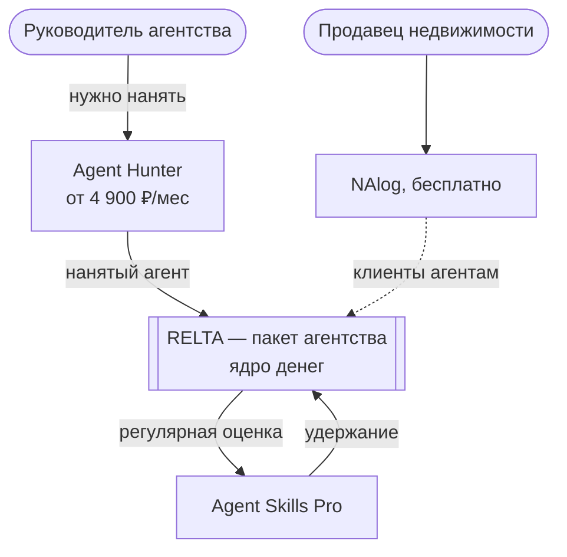
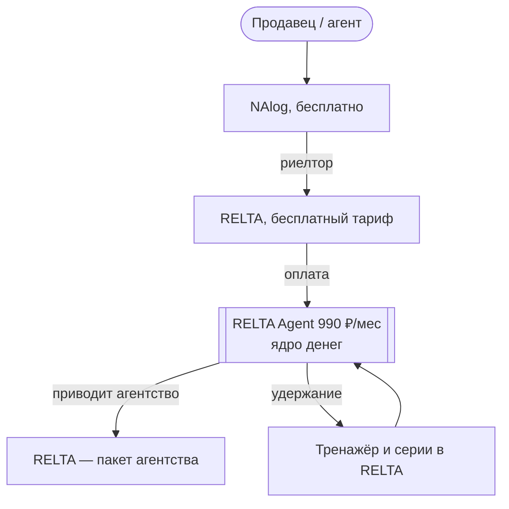
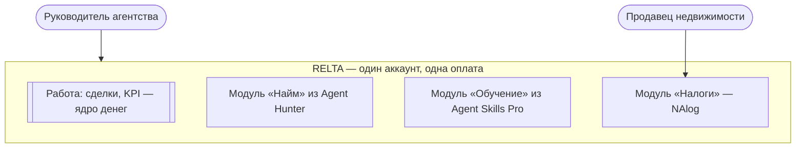

# Решение: экосистема продуктов для рынка недвижимости

Дата подготовки: 2026-11-02 · Подготовил: AI CEO · Участники: CSO, CPO · Задача: T-20261102-01
Статус: вынесено на обсуждение с собственником (D-009)

## Проблема
Собственник хочет экосистему для рынка недвижимости: RELTA, Agent Hunter, Agent Skills Pro, NAlog и
Brokers City как площадку для информации о проектах. Сейчас это пять отдельных продуктов на трёх стеках,
без связей между собой и без платящих клиентов (D-007).

## Исходные данные
- `[ФАКТ: код, CPO]` Связей между продуктами в коде нет. Тренажёр есть в трёх вариантах (RELTA — текст,
  Agent Hunter — голос внутри оценки кандидата, Agent Skills Pro — текст, этап 1 из 0–6). Скоринг — в трёх
  реализациях. Налогов в RELTA нет («налоги не вычтены», `ObjectsTab.tsx:270`) — этот пробел закрывает NAlog.
- `[ФАКТ: CPO]` Функции «размещать информацию о проектах» в Brokers City нет ни в коде, ни в документах.
  Игра не запущена: хостинга и домена нет, работа стоит с 08.10.
- `[ФАКТ: CSO, карточки]` Цены не выстроены в лестницу: вход Agent Hunter «Старт» 4 900 ₽, а пакет ядра
  RELTA на 5 мест — 3 900 ₽ (780 ₽ за место против 990 ₽ у одиночного агента).
- `[ФАКТ: CSO]` Пять баз на двух СУБД (Postgres/Prisma — RELTA, Skills Pro, Brokers City; MySQL — Agent
  Hunter, NAlog); четыре продукта на одном сервере.
- `[ВНЕШНИЙ: Контур.Фокус через finance.mail.ru, 2026 — не сверено с первоисточником]` Риелторских компаний
  на 01.01.2026 — 53,6 тыс. (+6,7% за год). Готовой экосистемы «найм + обучение + CRM + налоги» поиск не
  нашёл; конкуренты за первое касание с агентом — Циан и «Домклик PRO», отраслевые CRM (JoyWork и др.).
- Не хватает: данных о реальных пользователях (Umami NAlog, статистика RELTA и Agent Hunter).

## Варианты логики экосистемы (CSO)
| | A. Воронка агентства | B. Снизу вверх через агента | C. Одна платформа |
|---|---|---|---|
| Кто платит первым | руководитель агентства | агент | руководитель агентства |
| Вход | Agent Hunter (найм — у руководителя есть бюджет) | NAlog и бесплатный тариф RELTA | RELTA |
| Ядро денег | пакет агентства в RELTA | Agent 990 ₽ → агент приводит агентство | пакет RELTA, Hunter и Skills Pro — модули |
| Удержание | Skills Pro — регулярная оценка навыков | тренажёр и серии в RELTA | всё в одном аккаунте |
| Главный минус | три продажи, три цены | у агентов мало денег, вход длинный | переделка двух продуктов |

### Схемы вариантов

Наглядно: https://claude.ai/artifact/VhN4AtJcy2WgKZbP8XUx2S. Двойная рамка — где деньги, пунктир — гипотеза
(связи в коде нет).

**A. Воронка агентства**

**B. Снизу вверх через агента**

**C. Одна платформа**

## Варианты границ продуктов (CPO)
- **1. По жизненному циклу агента:** Agent Hunter — найм; Skills Pro — обучение и оценка; RELTA — работа;
  NAlog — бесплатный вход. Плюс: ничего не переносить. Минус: два тренажёра (RELTA и Skills Pro) у одного
  покупателя, четыре продукта без выручки при одном владельце.
- **2. Два ядра + сервисы:** RELTA — работа и обучение (Skills Pro отдаёт ей сильные части как модуль);
  Agent Hunter — найм; NAlog — калькулятор и источник трафика; Brokers City — вне ядра. Плюс: меньше
  кода и затрат. Минус: перенос не бесплатен (недели — оценка CTO нужна), RELTA ещё больше.
- В любом варианте у Skills Pro есть ценное своё: оценка, которую считает код (а не ИИ), с проверкой
  цитат; тренажёр техник СПИН и скриптов агентства; профиль навыков для руководителя. Голос и телефонию
  там строить не стоит — они уже есть в Agent Hunter и RELTA.

## Brokers City как площадка (CSO)
- Может дать: тематику коммерческой недвижимости; «частные миры» для агентств (обучение, соревнования,
  отбор кандидатов, 30–150 тыс ₽ за мир — предложение 05.08.2026, не утверждено).
- Не может дать сейчас: аудиторию (её нет), попадание в покупателя (игроки стратегий ≠ руководители
  агентств), окупаемое привлечение (по расчёту самого документа ~120 ₽ дохода на игрока).
- Дешёвая альтернатива для витрины: общий сайт экосистемы с единой заявкой — дни работы `[ПРЕДПОЛОЖЕНИЕ]`.

## Позиции директоров и расхождения
- CSO: сначала один продукт должен получить платящих, остальные пристраиваются; общую инфраструктуру
  (единый аккаунт) строить рано. Brokers City как площадку — отложить, спрос на «частные миры» проверить
  опросом 3–5 агентств.
- CPO: склоняется к границам «2» и к паузе этапа 2 Skills Pro до проверки спроса. Первый шаг — связка
  NAlog ↔ RELTA.
- Расхождений по существу нет; CPO сменил позицию с нейтральной (обзор портфеля) на вариант 2.

## Рекомендация AI CEO `[РЕКОМЕНДАЦИЯ]`
1. **Экосистему начинать не с инфраструктуры, а с одной проверяемой связки** — NAlog ↔ RELTA
   (CPO, связки №1–2): на результате расчёта NAlog — блок для риелтора со ссылкой в RELTA; в карточке
   сделки RELTA — кнопка «Налог для продавца» с предзаполненными ценой и типом объекта. Порядка 1–4 дней
   разработки `[ПРЕДПОЛОЖЕНИЕ, оценка CTO нужна]`, без общего аккаунта. Совпадает с монетизацией NAlog (тема 2).
2. **Витрина экосистемы — общий сайт с единой заявкой**, а не Brokers City; игре — самостоятельный путь,
   «частные миры» проверить опросом агентств до покупки хостинга.
3. **Skills Pro — пауза этапа 2** до решения о границах; сильные части (оценка кодом, СПИН-тренажёр)
   сохранить как кандидатов в модуль.
4. **Цены выровнять в лестницу** после выбора варианта (CRO).

Ожидаемый результат за 4 недели: видно, приводит ли NAlog риелторов в RELTA и пользуются ли брокеры
налоговым расчётом. Критерий (CPO): ≥20 переходов NAlog → RELTA и ≥3 регистрации; кнопкой «Налог для
продавца» пользуется ≥⅓ активных брокеров. Пороги уточнить после выгрузки Umami.

## Что нужно от собственника
1. **Кто первый платящий клиент экосистемы:** руководитель агентства (A/C) или агент (B)?
2. **Brokers City:** самостоятельная игра или инструмент экосистемы? Что вы имели в виду под «площадкой» —
   витрину для игроков, обучение агентов через игру или другое?
3. **Границы:** вариант 1 или 2 (судьба Skills Pro как отдельного продукта).
4. Разрешить первый шаг (связка NAlog ↔ RELTA) — тогда команда подготовит задания для сессий двух проектов.
5. Выгрузка Umami по NAlog за последний месяц (посетители, завершённые расчёты) — базовый уровень для критерия.
